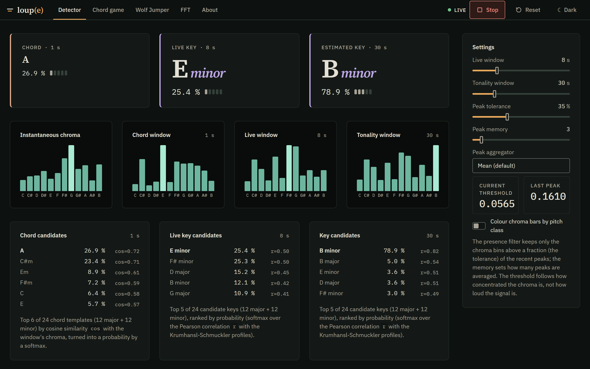

# AudioLab

**Real-time audio analysis in the browser, as a reusable SDK: key and chord detection,
spectrum and noise floor, tempo estimation and two microphone-driven ear-training games,
built on the Web Audio API with hand-written, unit-tested DSP.**

[](https://github.com/Dicdaplon/AudioLab/actions/workflows/ci.yml)
[](https://github.com/Dicdaplon/AudioLab/actions/workflows/deploy.yml)
[](LICENSE)
[](tsconfig.base.json)

**Live demo: <https://dicdaplon.github.io/AudioLab/>** (needs a microphone; nothing is
recorded or uploaded, all processing happens locally in the page).



## Packages

This repository is an npm workspace. The analysis and the UI are published as two
packages; the demo app only composes them.

| Package                                       | Path             | Contents                                                                                                                                                                                    |
| --------------------------------------------- | ---------------- | ------------------------------------------------------------------------------------------------------------------------------------------------------------------------------------------- |
| [`@audiolab/core`](packages/core/README.md)   | `packages/core`  | Framework-free TypeScript: DSP (chroma, key, chord, FFT, filters), `TonalityEngine`, `TempoAnalyzer`, Web Audio adapters, settings. Node-only file pipeline under `@audiolab/core/offline`. |
| [`@audiolab/react`](packages/react/README.md) | `packages/react` | React 18/19 hooks, components, canvas plots, the chord game and Wolf Jumper, theme helpers, and the Loupe design system (`styles.css`, optional `fonts.css`). SSR-safe, `"use client"`.     |
| `@audiolab/lab` (private)                     | `apps/lab`       | The demo above: a Vite shell (brand, tabs, theme toggle) around the SDK, deployed to GitHub Pages.                                                                                          |

### Quick start for consumers

```bash
npm install @audiolab/react @audiolab/core
```

```tsx
"use client";
import "@audiolab/react/styles.css";

import { DEFAULT_DETECTOR_SETTINGS } from "@audiolab/core";
import { DetectorTab, LoupeRoot, MicTransport, useMicrophone, useTonality } from "@audiolab/react";
import { useState } from "react";

export function KeyFinder() {
  const [settings, setSettings] = useState(DEFAULT_DETECTOR_SETTINGS);
  const [colourByPitch, setColourByPitch] = useState(false);
  const microphone = useMicrophone();
  const tonality = useTonality(microphone.mic, settings);
  return (
    <LoupeRoot>
      <MicTransport
        state={microphone.running ? "live" : "idle"}
        onStart={microphone.start}
        onStop={microphone.stop}
        onReset={tonality.reset}
      />
      <DetectorTab
        data={tonality}
        settings={settings}
        onSettingsChange={setSettings}
        colourByPitch={colourByPitch}
        onColourByPitchChange={setColourByPitch}
      />
    </LoupeRoot>
  );
}
```

Everything the SDK draws lives under the `.loupe` root rendered by `LoupeRoot`: the
tokens (`--al-*`) and classes (`al-*`) cannot leak into the host page, and the theme
follows the host's `<html data-theme="dark" | "light">` (or the OS preference). For a
Next.js App Router setup, theming, CSS scoping, microphone permissions, two-repository
development and releases, read [docs/INTEGRATION.md](docs/INTEGRATION.md).

## Features

- **Live key detection.** Krumhansl–Schmuckler correlation over all 24 major and minor
  keys, on two sliding windows (8 s "live" and 30 s "tonality", both adjustable).
- **Presence-based key detection.** An adaptive high-water-mark filter keeps only the
  dominant pitch classes, and a 30 s histogram of how often each note was present is
  ranked against the same key profiles.
- **Chord detection.** 24 major/minor triad templates scored by cosine similarity on a
  1 s chroma window.
- **Spectrum view.** AnalyserNode magnitude spectrum (0–4 kHz) with a noise-floor
  estimate (median, mean or 80th percentile), an optional slope overlay and A minor
  pentatonic reference lines.
- **Tempo analysis.** Gapless sample capture on the audio thread (AudioWorklet),
  onset-strength envelope, beat spectrum on a 40–240 BPM axis and a prior-weighted BPM
  estimate.
- **Chord game.** Ear-training: play the requested chord; a hit needs a stable detection
  over several frames. Six chord pools, from open guitar chords to all 24 triads.
- **Wolf Jumper.** A small arcade game: play the note shown on an incoming enemy to
  destroy it, play chords to collect bonuses. Includes an adjustable noise gate.

## How it works

```text
Microphone ─► MediaStreamAudioSourceNode ─┬─► AnalyserNode (FFT 16384, Blackman, dB) ── polled at 10 Hz
                                          │      ├─► TonalityEngine ─► chroma ─► windows ─► keys / chords / presence
                                          │      └─► spectrum + noise floor             (FFT tab only)
                                          └─► AudioWorklet "sample-capture"             (FFT tab only)
                                                 └─► TempoAnalyzer ─► onset envelope ─► beat spectrum ─► BPM
```

**Capture.** `getUserMedia` opens a mono stream with echo cancellation, noise
suppression and automatic gain control disabled, because all three reshape the
spectrum. A single microphone session is shared by every tab.

**Spectrum and chroma.** Ten times per second the AnalyserNode spectrum (16384-point
FFT, 2.93 Hz bins at 48 kHz) is converted back to linear magnitude and folded into a
12-bin chroma vector: the energy of every bin between 55 Hz and 5 kHz is added to the
pitch class nearest to its centre frequency, and the vector is normalised to sum to 1.

**Sliding windows.** The chroma frames are averaged over three ring buffers (1 s, 8 s,
30 s by default) with O(12) incremental updates. Because every frame is normalised,
the windows weigh loud and quiet passages equally.

**Detection.** Keys: Pearson correlation of the window chroma with the
Krumhansl–Kessler major and minor profiles rotated to each of the 12 tonics, turned into
a ranking score by a softmax (τ = 0.1). Chords: cosine similarity with 24 binary triad
templates, same softmax. Presence: the 8 s chroma is thresholded at a fraction of its
recent peak, binarised, and averaged over 30 s before the same key correlation.

**Tempo.** Tempo is invisible in the audio spectrum; it lives in the loudness envelope.
The worklet streams every sample to the main thread, where blocks of 128 samples are
turned into a log-compressed, half-wave rectified RMS difference (onset strength),
smoothed by a 4th-order Butterworth lowpass, decimated to about 94 Hz, and analysed
over 8 s with a zero-padded FFT. The peak of the spectrum, weighted by a log-Gaussian
tempo prior centred on 120 BPM, gives the estimate.

Deep dives: [docs/THEORY.md](docs/THEORY.md) (the maths and DSP decisions, with
numbers), [docs/ARCHITECTURE.md](docs/ARCHITECTURE.md) (package boundaries, layers,
data flow, threads, extension points) and [docs/INTEGRATION.md](docs/INTEGRATION.md)
(using the SDK from another application).

## Tech stack

| Area     | Choice                                                                                               |
| -------- | ---------------------------------------------------------------------------------------------------- |
| UI       | React 19 in the lab (SDK peer range `^18.2 \|\| ^19`), plain CSS, canvas plots (no chart library)    |
| Language | TypeScript (strict), ES modules                                                                      |
| Packages | npm workspaces, tsup (ESM + `.d.ts`), export maps, Changesets, publint + arethetypeswrong in CI      |
| Build    | Vite 5 for the lab (`base: "./"` for Pages); the AudioWorklet is bundled to a string and Blob-loaded |
| Audio    | Web Audio API: `getUserMedia`, `AnalyserNode`, `AudioWorkletNode`                                    |
| DSP      | Hand-written: radix-2 FFT, chroma, Butterworth biquads, key/chord scoring (no DSP deps)              |
| Tests    | Vitest 2 (unit / dom / samples projects), Testing Library, jsdom, v8 coverage                        |
| Quality  | ESLint 9 (typescript-eslint, react-hooks, package-boundary rules), Prettier                          |
| CI/CD    | GitHub Actions: checks + coverage + package checks, sample regression suite, GitHub Pages deploy     |

The packages have no runtime dependencies besides `react` / `react-dom` (peers of
`@audiolab/react`).

## Getting started (this repository)

Requirements: **Node.js ≥ 20** (`.nvmrc` pins 20) and npm.

```bash
git clone https://github.com/Dicdaplon/AudioLab.git
cd AudioLab
npm ci
npm run dev        # http://127.0.0.1:5173 (the lab, served from the package sources)
```

Start the microphone from the page and allow access when the browser asks. Browsers only
expose `getUserMedia` in a secure context: `localhost`/`127.0.0.1` or HTTPS. Opening the
dev server through a LAN IP over plain HTTP shows an "insecure context" error instead of
the permission prompt.

## Scripts

| Command                    | What it does                                                                        |
| -------------------------- | ----------------------------------------------------------------------------------- |
| `npm run dev`              | Vite dev server for the lab on `127.0.0.1:5173`, packages resolved from source      |
| `npm run build`            | Builds both packages (tsup), then the lab against their `dist` into `apps/lab/dist` |
| `npm run build:packages`   | Only the packages                                                                   |
| `npm run check:packages`   | publint + arethetypeswrong on the packed tarballs                                   |
| `npm run preview`          | Serve the production build of the lab locally                                       |
| `npm test`                 | Fast suite: Vitest `unit` + `dom` projects                                          |
| `npm run test:watch`       | Same projects in watch mode                                                         |
| `npm run test:samples`     | Regression suite on the real audio fixtures in `packages/core/tests/Sample`         |
| `npm run test:all`         | All three projects                                                                  |
| `npm run coverage`         | Fast suite with v8 coverage and enforced thresholds                                 |
| `npm run typecheck`        | `tsc -b` over the packages, the lab, their tests and the config files               |
| `npm run lint`             | ESLint                                                                              |
| `npm run format`           | Prettier, write                                                                     |
| `npm run format:check`     | Prettier, check only                                                                |
| `npm run changeset`        | Record a change for the next release                                                |
| `npm run version-packages` | Apply pending changesets (versions, changelogs, lock file)                          |
| `npm run release`          | Build, check and publish the packages (manual, see INTEGRATION.md)                  |
| `npm run sweep`            | Grid search of the chord and presence parameters over the samples                   |
| `npm run extract:backing`  | Cut three 30 s WAV extracts from each track in `packages/core/localSample/`         |
| `npm run analyze:backing`  | Print chord histogram and key rankings for the backing-track extract                |

## Testing strategy

The DSP lives in plain TypeScript modules with no browser dependency, so most of it is
tested in Node against signals whose answer is known analytically.

| Vitest project | Files                                      | Environment | Content                                                                                                         |
| -------------- | ------------------------------------------ | ----------- | --------------------------------------------------------------------------------------------------------------- |
| `unit`         | `packages/*/tests/**/*.test.ts`, `apps/*`  | Node        | DSP maths, engines, offline pipeline, audio adapters against a fake Web Audio API, game logic, server rendering |
| `dom`          | `packages/*/tests/**/*.test.tsx`, `apps/*` | jsdom       | Hooks (start/stop races, worklet and fallback capture), components, hydration, the lab shell                    |
| `samples`      | `packages/core/tests/samples/*.test.ts`    | Node        | Real recordings decoded from MP3/WAV and run through the shared `TonalityEngine`                                |

- **Synthetic signals.** Seeded generators (`packages/core/tests/helpers/synth.ts`)
  produce tones, chords, scales and click tracks; an AnalyserNode emulation
  (`liveRig.ts`) frames them exactly like the live hook, including the dB round-trip.
  Examples: a bin-centred sine reads 0 dB in `computeFftDb`; the Butterworth filter is
  −3.01 dB at the cutoff; click tracks at 90–180 BPM are estimated within 3 BPM; I–IV–V–I
  and i–iv–V–i cadences in all 24 keys are ranked first by all three key paths; all 24
  triads are detected top-1.
- **Real audio.** 17 fixtures (clean guitar recordings, FL Studio renders with drums and
  noise, backing-track extracts). Assertions pin the measured ranks with a small slack,
  e.g. "the 4 most frequent chords of `CAmDmG_2_1.mp3` are exactly {D, Bm, Em, A}".
- **Package shape.** The generated worklet string is compared with a fresh bundle; every
  view is rendered with `react-dom/server` in Node and hydrated in jsdom without
  recoverable errors.
- **Measured on the current `main`:** `npm run coverage` runs 481 tests in 48 files
  (about 8 s); `npm run test:samples` runs 44 tests in 4 files (about 6 s).

Coverage (v8, unit + dom) and the thresholds enforced in
[`vitest.config.ts`](vitest.config.ts):

| Scope                               | Lines (measured / min) | Branches (measured / min) | Functions (measured / min) |
| ----------------------------------- | ---------------------- | ------------------------- | -------------------------- |
| All package and lab sources         | 98.8 % / 86 %          | 95.4 % / 92 %             | 96.9 % / 93 %              |
| `packages/core/src/analysis`        | 99.3 % / 99 %          | 97.7 % / 97 %             | 100 % / 100 %              |
| `packages/core/src/analysis/engine` | 100 % / 99 %           | 97.3 % / 96 %             | 100 % / 100 %              |
| `packages/core/src/offline`         | 100 % / 99 %           | 95.1 % / 93 %             | 100 % / 100 %              |
| `packages/core/src/audio`           | 100 % / 99 %           | 94.5 % / 92 %             | 100 % / 100 %              |
| `packages/react/src/hooks`          | 100 % / 99 %           | 100 % / 98 %              | 100 % / 100 %              |

**CI** ([`.github/workflows/ci.yml`](.github/workflows/ci.yml)) runs on every push to
`main` and every pull request, in two jobs: `check` (typecheck, lint, format check,
coverage with thresholds, coverage report uploaded as an artifact, package and lab
builds, publint + arethetypeswrong) and `samples` (the real-audio regression suite).
[`deploy.yml`](.github/workflows/deploy.yml) builds and publishes `apps/lab/dist` to
GitHub Pages on every push to `main`.

## Project structure

```text
packages/core/                @audiolab/core
├── src/
│   ├── index.ts              Public API (explicit re-exports)
│   ├── analysis/             Pure TypeScript DSP, no DOM or Web Audio
│   │   ├── chroma.ts         dB → magnitude, spectrum → 12-bin chroma
│   │   ├── windowing.ts      ChromaWindow: ring buffer with incremental mean
│   │   ├── keyDetection.ts   Krumhansl–Schmuckler, 24 keys, Pearson + softmax
│   │   ├── chordDetection.ts 24 triad templates, cosine + softmax
│   │   ├── highWaterMark.ts  Adaptive peak-relative threshold filter
│   │   ├── presenceTonality.ts  Key ranking from a presence histogram
│   │   ├── fft.ts · timeFft.ts · lowpass.ts · noiseFloor.ts · spectrumSlope.ts · timeBuffer.ts · math.ts
│   │   └── engine/           TonalityEngine (per-frame pipeline), TempoAnalyzer (onset → beat spectrum → BPM)
│   ├── audio/                Web Audio adapters: micStream, errors, analyser, sampleCapture (+ worklet, bundled string)
│   ├── offline/              `@audiolab/core/offline`: file decoding, framing (Node only)
│   ├── config/settings.ts    Settings types and defaults
│   └── utils/notes.ts        Note maths
├── scripts/                  buildWorklet, parameter sweep and backing-track tools (tsx)
└── tests/                    Mirrors src; helpers/ (fake Web Audio, synth, live rig), samples/, Sample/ (audio)
packages/react/               @audiolab/react
├── src/
│   ├── index.ts              Public API
│   ├── LoupeRoot.tsx         The `.loupe` root and its context
│   ├── hooks/                useMicrophone, useTonality, useTempoAnalysis
│   ├── components/           Detector views, FFT tab, canvas plots, controls, transport, tabs
│   ├── games/                Chord game and Wolf Jumper (pure engines + views), useConfirmedDetection
│   ├── ui/                   Icons, canvas helpers, viz theme, theme contract, media queries
│   └── styles/               Loupe tokens and component styles (bundled to styles.css), fonts.css
└── tests/                    Components, hooks, games, SSR and hydration smoke tests
apps/lab/                     The demo app: index.html, App.tsx (shell + tabs), app.css, smoke test
docs/                         ARCHITECTURE.md, THEORY.md, INTEGRATION.md
.changeset/                   Pending release notes
```

## Known limitations

- **Tempo octave errors.** A pulse train has envelope harmonics at 1×, 2×, 3× the beat
  rate, so the estimate can be half or double the felt tempo (a 60 BPM click is reported
  as 120 BPM). Resolution is 7.5 BPM before peak interpolation (8 s window). No beat
  phase tracking.
- **Low-frequency pitch resolution.** The AnalyserNode's Blackman main lobe is about
  ±9 Hz wide; semitones are only cleanly separated from roughly 220 Hz upwards. Bass
  notes below ~150 Hz leak into neighbouring pitch classes.
- **Relative major/minor ambiguity.** A minor key and its relative major share all
  seven notes; the profiles only separate them by emphasis on the tonic, so both often
  rank together. The sample tests accept either.
- **Harmonics.** The chroma has no harmonic suppression: the 5th harmonic adds a major
  third, which can push minor chords towards major.
- **Vocabulary.** Major and minor triads only (no sevenths, sus, diminished or
  augmented); Western 12-TET tuning with A4 = 440 Hz; mono input.
- **Scores are not probabilities.** The softmax outputs rank candidates and sum to 1,
  but they are not calibrated confidences.
- **Main-thread analysis.** The spectrum is polled with `setInterval` on the main thread;
  a throttled background tab slows the key and chord updates.
- **Tuning data.** Default filter parameters come from a sweep over a small set of
  recordings, framed offline at about 21.5 fps with a Hann window, not the live 10 fps
  Blackman front-end.

## License

[MIT](LICENSE) © dicdaplon
