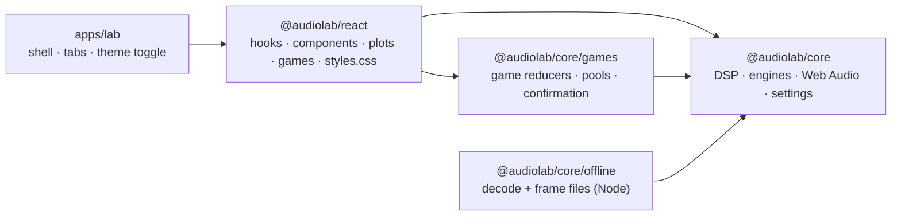
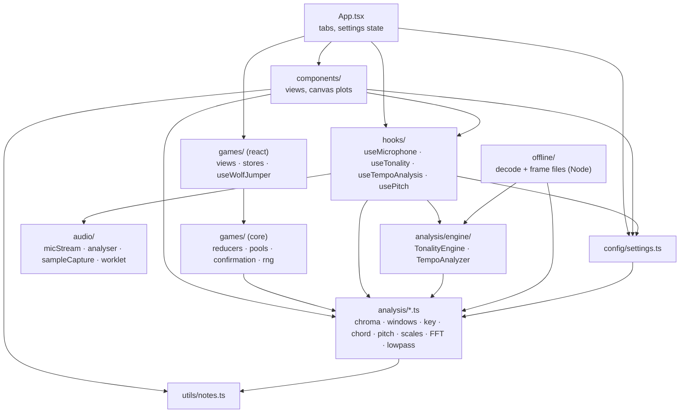
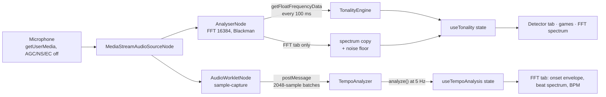
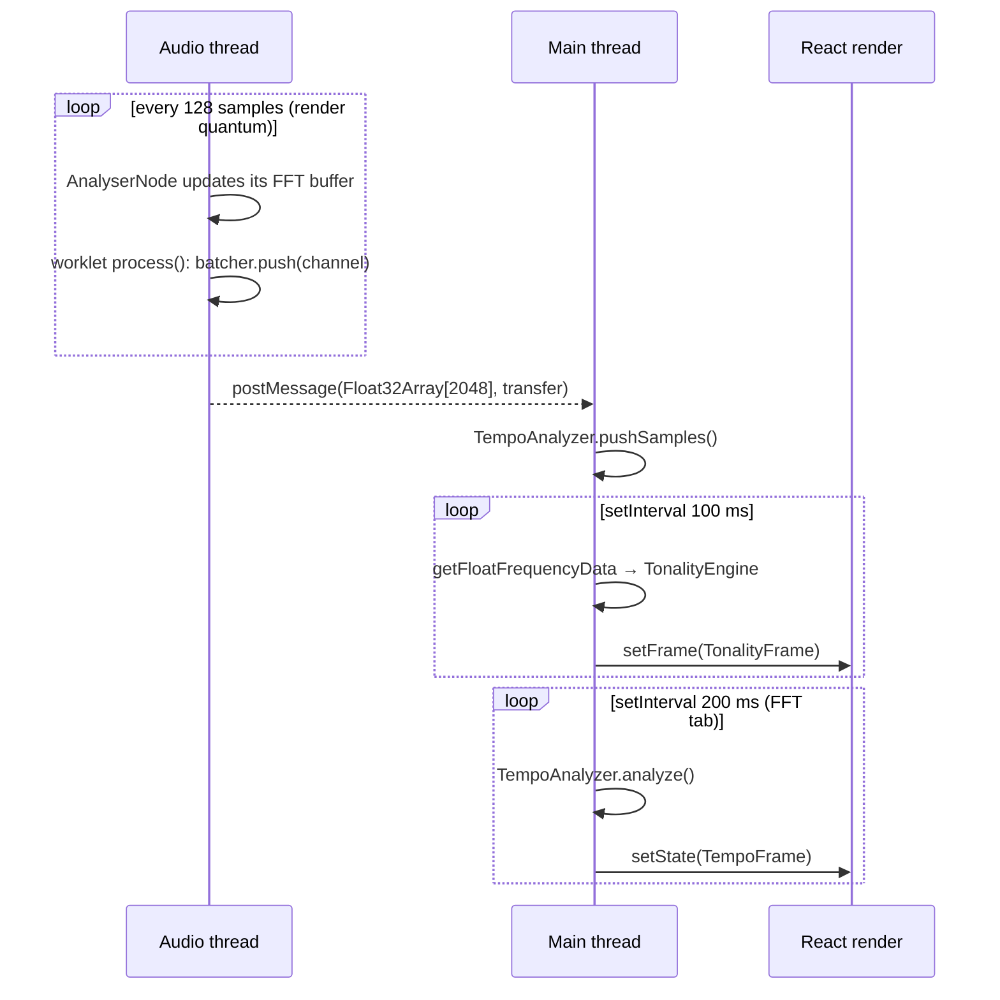

# Architecture

How AudioLab is organised, how audio flows from the microphone to the screen, and where to
plug in new analyses. For the maths behind each stage, see [THEORY.md](THEORY.md); for
mounting the SDK in another application, see [INTEGRATION.md](INTEGRATION.md).

## Packages

The repository is an npm workspace with two publishable packages and one private app.

| Package           | Path             | What it is                                                                                                                               | Depends on                                      |
| ----------------- | ---------------- | ---------------------------------------------------------------------------------------------------------------------------------------- | ----------------------------------------------- |
| `@audiolab/core`  | `packages/core`  | Framework-free TypeScript: DSP (incl. pitch and scales), engines, Web Audio adapters, settings, note maths; game engines under `./games` | nothing (`audio-decode` optional, offline only) |
| `@audiolab/react` | `packages/react` | Hooks, components, canvas plots, games, theme helpers and the Loupe stylesheets                                                          | `@audiolab/core`; peers `react`, `react-dom`    |
| `@audiolab/lab`   | `apps/lab`       | The demo app deployed to GitHub Pages: a shell (brand, top bar, tabs) composing the SDK                                                  | both packages                                   |

Dependencies point one way: **lab → react → core**. Core never imports React or a Node
built-in outside its `offline` subpath (ESLint enforces both), so the signal processing is
testable in Node with synthetic signals and real recordings, and a browser bundle never
pulls `node:fs`. The lab contains no analysis or UI code of its own; if something is
needed there, it belongs in a package.

Each package has one main entry (`src/index.ts`) that is the public API; core adds two
subpaths, `@audiolab/core/games` (the pure game engines, browser-safe) and
`@audiolab/core/offline` (Node only). Everything not re-exported from an entry is
internal. Workspace consumers resolve the packages through the
`audiolab-source` export condition (TypeScript `customConditions`, Vite / Vitest
`resolve.conditions`), so development and tests run from the sources; the production
build of the lab and external consumers use the `dist` built by tsup.

## Layers

| Layer        | Path                                 | Depends on                          | Browser APIs       | Tested in             |
| ------------ | ------------------------------------ | ----------------------------------- | ------------------ | --------------------- |
| Notes        | `core/src/utils/notes.ts`            | nothing                             | none               | Node                  |
| DSP          | `core/src/analysis/*.ts`             | notes                               | none               | Node                  |
| Pitch        | `core/src/analysis/pitch.ts`         | fft, math, notes                    | none               | Node (synthetic)      |
| Scales       | `core/src/analysis/scales.ts`        | chroma (size)                       | none               | Node                  |
| Engines      | `core/src/analysis/engine/`          | DSP modules                         | none               | Node                  |
| Offline      | `core/src/offline/`                  | engines, DSP, `audio-decode`        | none (Node only)   | Node, samples         |
| Settings     | `core/src/config/`                   | DSP (types and defaults)            | none               | Node                  |
| Audio        | `core/src/audio/`                    | nothing else in core                | Web Audio, media   | Node + fake Web Audio |
| Game engines | `core/src/games/`                    | chord templates, chroma size        | none               | Node                  |
| Hooks        | `react/src/hooks/`                   | core                                | via `audio`        | jsdom                 |
| UI helpers   | `react/src/ui/`                      | core (types), React                 | canvas, matchMedia | jsdom                 |
| Game views   | `react/src/games/`                   | core/games, hooks, ui               | none in stores     | Node + jsdom          |
| Components   | `react/src/components/`, `LoupeRoot` | hooks, ui, core                     | canvas             | jsdom                 |
| App          | `apps/lab/src/App.tsx`               | `@audiolab/react`, `@audiolab/core` | none               | jsdom (smoke)         |

## Data flow

One microphone session feeds two independent analysis paths.

### 1. Microphone session (`useMicrophone`, `audio/micStream.ts`)

`openMicrophone(options?)` checks the environment first (secure context, `mediaDevices`,
`AudioContext`), then calls `getUserMedia` with echo cancellation, noise suppression and
auto gain control turned off and one channel requested. It creates the `AudioContext`,
resumes it if suspended, and returns a `MicSource` with an idempotent `dispose()`. A
host that owns a context (Tone.js) or a stream passes them in `options`: the SDK then
resumes but never closes the context, never stops the host's tracks, and reports what
it owns in `ownsContext` / `ownsStream`. Any failure is mapped by `audio/errors.ts` to
a stable code (`permission-denied`, `no-device`, `insecure-context`, ...) and an
actionable message.

`useMicrophone` owns the single session shared by every tab. It is race-safe: a second
`start()` while one is pending is ignored, and a session token makes a `stop()` or an
unmount during the permission prompt dispose the stream as soon as it arrives (this also
covers React StrictMode's double mount). The environment check is exposed as
`unsupported`, run after mount so server-rendered markup never disagrees with the client.

### 2. Key and chord path (`useTonality`, `TonalityEngine`)

`useTonality(mic, options)` creates a `TonalityEngine` and hands it to `startLiveAnalysis`
(core), which puts an AnalyserNode (`fftSize` 16384, smoothing 0) on the session and polls
it with `setInterval` at `framesPerSecond` (10 Hz); hosts without React call the same
function. Each tick:

1. `readSpectrumDb()` fills a pre-allocated buffer with the dB spectrum.
2. `engine.processDbSpectrum()` converts it to magnitude (−90 dB gate), folds it into a
   chroma, pushes it into the chord, live and tonality windows, runs the high-water-mark
   filter on the live window and pushes the resulting indicator into the presence window,
   then returns a `TonalityFrame` (all chromas, rankings, filter state, signal level).
   The chord ranking covers the 24 triads unless `chordQualities` enables more.
3. When the FFT tab is visible (`fftEnabled`), the dB spectrum is copied and the noise
   floor is estimated over 0–4 kHz. Other tabs skip this work.

Settings changes call `engine.configure()`: windows are resized in place, keeping their
most recent frames, so moving a slider does not reset the analysis. `reset()` clears the
windows without closing the microphone.

`TonalityEngine` has no browser dependency. The same class is driven by the offline
pipeline (`@audiolab/core/offline`) from decoded files, so the sample regression tests run
the code that runs in the browser from the chroma onwards.

### 3. Tempo path (`useTempoAnalysis`, `TempoAnalyzer`)

`useTempoAnalysis` is mounted only by the FFT tab. It creates a `TempoAnalyzer` for the
context's sample rate and calls `startSampleCapture()`:

- **Preferred: AudioWorklet.** `sampleCapture.worklet.ts` runs on the audio rendering
  thread, collects the 128-sample render quanta into 2048-sample batches
  (`SampleBatcher`) and transfers each batch to the main thread with `postMessage`
  (about 23 messages per second at 48 kHz). The node outputs silence and is connected to
  the destination so the graph keeps rendering it. The processor is bundled to a string
  at build time (`scripts/buildWorklet.ts` → `sampleCaptureWorklet.source.ts`, committed
  and checked by a test) and loaded through a Blob URL, so consumers need no bundler
  support for worklets.
- **Fallback: AnalyserNode polling** every 20 ms, used when there is no AudioWorklet or
  the module fails to load (for instance a CSP without `blob:`). The number of new
  samples is measured from `context.currentTime`, so late timer ticks neither drop nor
  duplicate audio; gaps longer than the 4096-sample window (throttled tab) are filled
  with zeros.

Every received batch goes straight into `analyzer.pushSamples()`, which updates the onset
envelope incrementally. A 5 Hz timer calls `analyze()` (FFT of the last 8 s of envelope)
and publishes the result. Leaving the tab unmounts the hook, which stops the capture and
the timer.

### 3b. Pitch path (`usePitch`, `PitchTracker`)

The tuner mounts `usePitch`, which starts its own `startSampleCapture()` on the session
(a second worklet node when the FFT tab is also open) and pushes every batch into a
`PitchTracker`: ring buffer of 2048 samples, one `detectPitch()` (MPM, two 4096-point
FFTs) every 1024 samples, median over three raw estimates, note-name hysteresis. A
20 Hz timer publishes the estimate to React only when it changed. The reference A4 is
applied to the tracker without restarting the capture.

### 4. UI

`LoupeRoot` renders the `.loupe` element that carries every design token
(`styles/tokens.css`) and exposes it through context; `useVizTheme` reads the `--al-viz-*`
tokens from that element with `getComputedStyle` (canvas code cannot use `var()`) and
re-reads them when `<html data-theme>` or the OS preference changes.

`App.tsx` (lab) holds the active tab and the settings (`DetectorSettings`,
`FftSettings` from core), calls `useMicrophone` and `useTonality`, and passes slices of
the `TonalityFrame` down:

- **Detector tab:** chroma bars (instantaneous, 1 s, live, tonality), chord ranking, two
  key rankings, presence view, and the settings panel.
- **Tuner tab (lab):** `usePitch` → note, octave, cents meter, frequency, clarity, A4.
- **Scales tab (lab):** `matchScales(presenceHistogram)` → ranked scales with their
  missing and outside notes, above an adjustable presence threshold.
- **Chord game:** consumes `chords` (1 s window). `useConfirmedDetection` (over
  `stepConfirmation` from `core/games`) turns the noisy per-frame top-1 into discrete
  events: a chord counts after 3 consecutive frames with a score of at least 0.18
  (`CHORD_GAME_DEFAULTS`, overridable by props). Pools, draws and scoring come from
  `core/games/chordGame.ts`; the component only adds the English labels.
- **Wolf Jumper:** consumes `instantaneousChroma` (notes: argmax of the last 3 frames,
  confirmed twice), `chords`, and `signalLevelDb` (noise gate), through the pure
  `WolfJumperDetector` of `core/games/wolfDetector.ts`, which turns each frame into
  reducer actions (the hook only dispatches them). The game itself is the
  pure reducer of `core/games/wolfJumper.ts` with a seeded RNG, its own game clock and a
  `config` resolved from `WOLF_JUMPER_DEFAULTS` (note pool, bonus chords, speeds,
  health...), held in a small external store so only the scene re-renders at display
  rate. Notes are pitch classes and bonus chords are `{ root, quality }`; the sprites
  name them with `pitchClassName` / `chordName`.
- **FFT tab:** spectrum plot with noise floor, slope and pentatonic overlays; onset
  envelope and beat spectrum from `useTempoAnalysis`.

Plots are drawn on `<canvas>` with helpers from `ui/plotMath.ts`; long signals are
reduced to one min/max pair per pixel column.

Every module of `@audiolab/react` is SSR-safe: no `window` / `document` access at module
scope, and nothing the server cannot know (media queries, stored theme, microphone
support, random draws) is read during the first render.

## Threads

Only the sample capture runs on the audio thread. The AnalyserNode's FFT is computed by
the browser; everything else (chroma, windows, detection, onset envelope, beat
spectrum) runs on the main thread. The per-frame cost is small: one pass over 8192 bins
plus O(12) window updates and 48 correlations of length 12 every 100 ms, and one
4096-point FFT every 200 ms for the tempo. The trade-off is that a throttled background
tab slows the key/chord updates; the worklet capture itself stays gapless.

## Build and deployment

- Each package is built by **tsup** (`packages/*/tsup.config.ts`): ESM, source maps and
  `.d.ts` in `dist/`. Chosen over Vite's library mode because one tool produces the
  bundle and the declarations, keeps dependencies external by reading `package.json`,
  and can re-insert the `"use client"` directive as a banner (bundlers drop per-module
  directives). `@audiolab/react` also emits `styles.css` (bundled partials) and
  `fonts.css` (its `@fontsource` imports kept external).
- `exports` maps declare `types` and `default` conditions plus the workspace-only
  `audiolab-source` condition; `sideEffects` is `false` for core and `["*.css"]` for
  react, so consumers tree-shake everything but the stylesheets.
- The lab is built by Vite with `base: "./"`, so the same build works at the GitHub
  Pages sub-path `/AudioLab/` and locally; `deploy.yml` publishes `apps/lab/dist` on every
  push to `main`.
- `npm run check:packages` runs publint and arethetypeswrong on the packed tarballs
  (CI does too). Versions and changelogs are managed with Changesets.

## Testing seams

- `packages/core/tests/helpers/fakeWebAudio.ts` fakes `AudioContext`, `AnalyserNode`,
  `AudioWorkletNode` and `getUserMedia`, so the hooks and audio adapters are tested in
  jsdom, including start/stop races and the worklet-to-fallback switch.
- `synth.ts` and `liveRig.ts` (same directory) generate deterministic audio and emulate
  the AnalyserNode framing, so `TonalityEngine` is tested end-to-end from samples.
- `@audiolab/core/offline` decodes real files in Node for the `samples` project and the
  scripts in `packages/core/scripts/`.
- `packages/react/tests/ssr.test.ts` renders every view with `react-dom/server` in plain
  Node, and `hydration.test.tsx` hydrates that markup in jsdom and fails on any
  recoverable error.

## Extension points

| To add...                        | Change                                                                                                                                                                                                         |
| -------------------------------- | -------------------------------------------------------------------------------------------------------------------------------------------------------------------------------------------------------------- |
| Chord qualities (aug, 9th...)    | Add intervals to `CHORD_QUALITY_INTERVALS`, a suffix, a base triad and a bias, and the quality to `ChordQuality` and `CHORD_QUALITIES` in `core/src/analysis/chordDetection.ts`; templates are built from it   |
| Other key profiles               | Replace or add entries in `KEY_PROFILES` (`keyDetection.ts`), e.g. Temperley or harmonic-minor profiles                                                                                                        |
| Harmonic weighting of the chroma | `spectrumToChroma()` in `chroma.ts`: per-bin weights or harmonic suppression before folding                                                                                                                    |
| A new per-frame analysis         | A pure module in `core/src/analysis/`, called from `TonalityEngine.pushChroma()` and exposed in `TonalityFrame`                                                                                                |
| A new sample-accurate analysis   | Another consumer of `startSampleCapture()` with its own engine class, mounted by the view that needs it                                                                                                        |
| A new component or game          | Rules as a pure reducer in `core/src/games/` (keys and pitch classes, no labels), exported from `games/index.ts`; the view in `packages/react`, re-exported from `src/index.ts` with `"use client"` at the top |
| A Wolf Jumper on another scale   | `createInitialState(seed, { notePool })`, or the `config` prop of `WolfJumper`; every other tuning value is in `WOLF_JUMPER_DEFAULTS`                                                                          |
| Another scale for the finder     | A `ScaleDefinition` (`{ id, intervals }`) passed to `matchScales`; add it to `SCALES` (and `SCALE_NAMES_EN`) to make it built-in                                                                               |
| A new regression fixture         | Drop the file under `packages/core/tests/Sample/` and assert its measured rank in `tests/samples/`                                                                                                             |
| Re-tuning the defaults           | `npm run sweep`, then update `HIGH_WATER_MARK_DEFAULTS` / `config/settings.ts`                                                                                                                                 |
| Changing the worklet             | Edit `sampleCapture.worklet.ts`, run `npm run build:worklet -w packages/core`, commit the regenerated source string                                                                                            |
