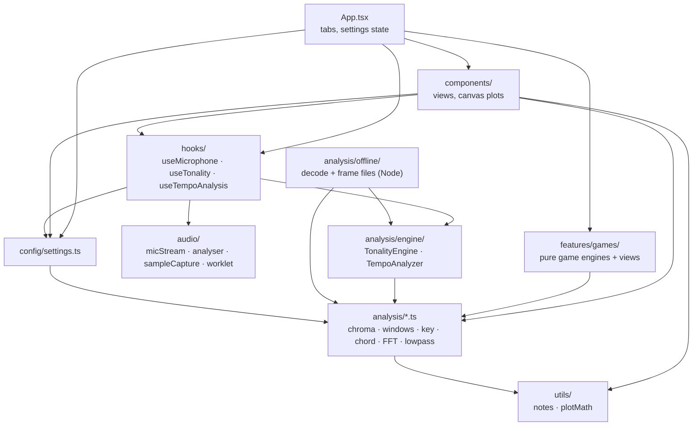
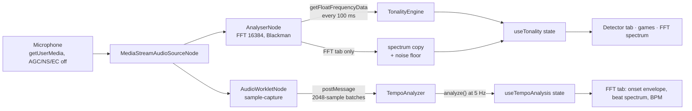
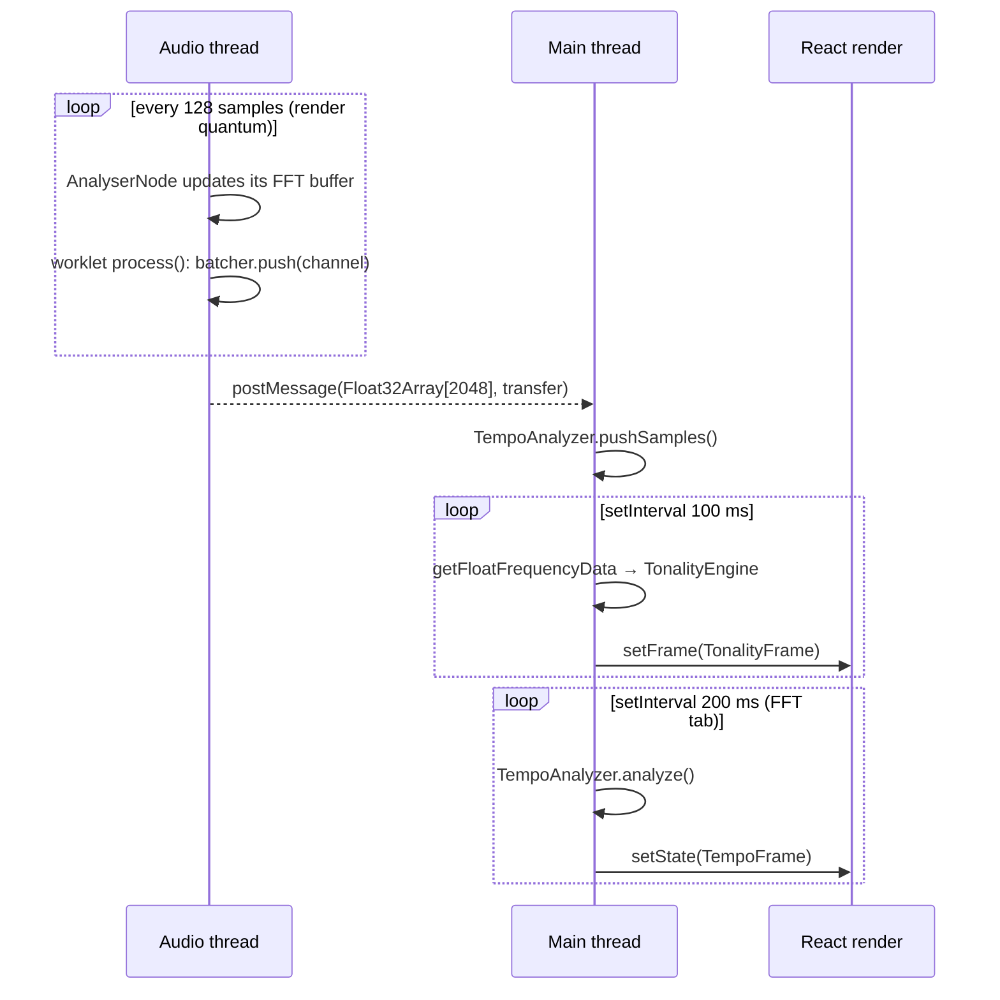

# Architecture

How AudioLab is organised, how audio flows from the microphone to the screen, and where to
plug in new analyses. For the maths behind each stage, see [THEORY.md](THEORY.md).

## Layers

| Layer      | Path                     | Depends on                             | Browser APIs     | Tested in             |
| ---------- | ------------------------ | -------------------------------------- | ---------------- | --------------------- |
| Utilities  | `src/utils/`             | nothing                                | none             | Node                  |
| DSP        | `src/analysis/*.ts`      | `utils`                                | none             | Node                  |
| Engines    | `src/analysis/engine/`   | DSP modules                            | none             | Node                  |
| Offline    | `src/analysis/offline/`  | engines, DSP, `audio-decode`           | none (Node only) | Node, samples         |
| Config     | `src/config/`            | DSP (types and defaults)               | none             | Node                  |
| Audio      | `src/audio/`             | nothing in `src/`                      | Web Audio, media | Node + fake Web Audio |
| Hooks      | `src/hooks/`             | audio, engines, DSP, config            | via `audio`      | jsdom                 |
| Games      | `src/features/games/`    | DSP (chord templates, chroma)          | none in engines  | Node + jsdom          |
| Components | `src/components/`, `App` | hooks, config, DSP, utils, audio types | canvas           | jsdom (partly)        |

Dependencies point one way: UI → hooks → (audio, engines) → DSP → utils. Nothing below
the hooks imports React, and nothing in `src/analysis/` touches the DOM or the Web Audio
API. That is what makes the signal processing testable in Node with synthetic signals and
real recordings.

## Data flow

One microphone session feeds two independent analysis paths.

### 1. Microphone session (`useMicrophone`, `audio/micStream.ts`)

`openMicrophone()` checks the environment first (secure context, `mediaDevices`,
`AudioContext`), then calls `getUserMedia` with echo cancellation, noise suppression and
auto gain control turned off and one channel requested. It creates the `AudioContext`,
resumes it if suspended, and returns a `MicSource` with an idempotent `dispose()`. Any
failure is mapped by `audio/errors.ts` to a stable code (`permission-denied`,
`no-device`, `insecure-context`, ...) and an actionable message.

`useMicrophone` owns the single session shared by every tab. It is race-safe: a second
`start()` while one is pending is ignored, and a session token makes a `stop()` or an
unmount during the permission prompt dispose the stream as soon as it arrives (this also
covers React StrictMode's double mount).

### 2. Key and chord path (`useTonality`, `TonalityEngine`)

`useTonality(mic, options)` creates an AnalyserNode (`fftSize` 16384, smoothing 0) on the
session and a `TonalityEngine`, then polls with `setInterval` at `framesPerSecond`
(10 Hz). Each tick:

1. `readSpectrumDb()` fills a pre-allocated buffer with the dB spectrum.
2. `engine.processDbSpectrum()` converts it to magnitude (−90 dB gate), folds it into a
   chroma, pushes it into the chord, live and tonality windows, runs the high-water-mark
   filter on the live window and pushes the resulting indicator into the presence window,
   then returns a `TonalityFrame` (all chromas, rankings, filter state, signal level).
3. When the FFT tab is visible (`fftEnabled`), the dB spectrum is copied and the noise
   floor is estimated over 0–4 kHz. Other tabs skip this work.

Settings changes call `engine.configure()`: windows are resized in place, keeping their
most recent frames, so moving a slider does not reset the analysis. `reset()` clears the
windows without closing the microphone.

`TonalityEngine` has no browser dependency. The same class is driven by the offline
pipeline (`analysis/offline/offlinePipeline.ts`) from decoded files, so the sample
regression tests run the code that runs in the browser from the chroma onwards.

### 3. Tempo path (`useTempoAnalysis`, `TempoAnalyzer`)

`useTempoAnalysis` is mounted only by the FFT tab. It creates a `TempoAnalyzer` for the
context's sample rate and calls `startSampleCapture()`:

- **Preferred: AudioWorklet.** `sampleCapture.worklet.ts` runs on the audio rendering
  thread, collects the 128-sample render quanta into 2048-sample batches
  (`SampleBatcher`) and transfers each batch to the main thread with `postMessage`
  (about 23 messages per second at 48 kHz). The node outputs silence and is connected to
  the destination so the graph keeps rendering it.
- **Fallback: AnalyserNode polling** every 20 ms. The number of new samples is measured
  from `context.currentTime`, so late timer ticks neither drop nor duplicate audio; gaps
  longer than the 4096-sample window (throttled tab) are filled with zeros.

Every received batch goes straight into `analyzer.pushSamples()`, which updates the onset
envelope incrementally. A 5 Hz timer calls `analyze()` (FFT of the last 8 s of envelope)
and publishes the result. Leaving the tab unmounts the hook, which stops the capture and
the timer.

### 4. UI

`App.tsx` holds the active tab and the settings (`DetectorSettings`, `FftSettings` from
`config/settings.ts`), calls `useMicrophone` and `useTonality`, and passes slices of the
`TonalityFrame` down:

- **Detector tab:** chroma bars (instantaneous, 1 s, live, tonality), chord ranking, two
  key rankings, presence view, and the settings panel.
- **Chord game:** consumes `chords` (1 s window). `useConfirmedDetection` turns the noisy
  per-frame top-1 into discrete events: a chord counts after 3 consecutive frames with a
  score of at least 0.18.
- **Wolf Jumper:** consumes `instantaneousChroma` (notes: argmax of the last 3 frames,
  confirmed twice), `chords`, and `signalLevelDb` (noise gate). The game itself is a pure
  reducer (`engine.ts`) with a seeded RNG and its own game clock, held in a small
  external store so only the scene re-renders at display rate.
- **FFT tab:** spectrum plot with noise floor, slope and pentatonic overlays; onset
  envelope and beat spectrum from `useTempoAnalysis`.

Plots are drawn on `<canvas>` with helpers from `utils/plotMath.ts`; long signals are
reduced to one min/max pair per pixel column.

## Threads

Only the sample capture runs on the audio thread. The AnalyserNode's FFT is computed by
the browser; everything else (chroma, windows, detection, onset envelope, beat
spectrum) runs on the main thread. The per-frame cost is small: one pass over 8192 bins
plus O(12) window updates and 48 correlations of length 12 every 100 ms, and one
4096-point FFT every 200 ms for the tempo. The trade-off is that a throttled background
tab slows the key/chord updates; the worklet capture itself stays gapless.

## Build and deployment

- Vite bundles the worklet as a separate file through the `?worker&url` import in
  `audio/sampleCaptureWorkletUrl.ts`. That one-line module exists so tests can mock the
  URL.
- `base: "./"` makes every asset URL relative, so the same build works at the GitHub
  Pages sub-path `/AudioLab/` and locally.
- `deploy.yml` builds on every push to `main` and publishes `dist/` with
  `actions/deploy-pages`.

## Testing seams

- `tests/helpers/fakeWebAudio.ts` fakes `AudioContext`, `AnalyserNode`,
  `AudioWorkletNode` and `getUserMedia`, so the hooks and audio adapters are tested in
  jsdom, including start/stop races and the worklet-to-fallback switch.
- `tests/helpers/synth.ts` and `liveRig.ts` generate deterministic audio and emulate the
  AnalyserNode framing, so `TonalityEngine` is tested end-to-end from samples.
- `analysis/offline/` decodes real files in Node for the `samples` project and the
  scripts in `scripts/`.

## Extension points

| To add...                        | Change                                                                                                                     |
| -------------------------------- | -------------------------------------------------------------------------------------------------------------------------- |
| Chord qualities (7th, sus, dim)  | Add intervals to `QUALITY_INTERVALS` and the quality to `ChordQuality` in `chordDetection.ts`; templates are built from it |
| Other key profiles               | Replace or add entries in `KEY_PROFILES` (`keyDetection.ts`), e.g. Temperley or harmonic-minor profiles                    |
| Harmonic weighting of the chroma | `spectrumToChroma()` in `chroma.ts`: per-bin weights or harmonic suppression before folding                                |
| A new per-frame analysis         | A pure module in `src/analysis/`, called from `TonalityEngine.pushChroma()` and exposed in `TonalityFrame`                 |
| A new sample-accurate analysis   | Another consumer of `startSampleCapture()` with its own engine class, mounted by the view that needs it                    |
| A new tab or game                | A component under `src/features/` reading the hook state passed from `App.tsx`; keep the rules in a pure reducer           |
| A new regression fixture         | Drop the file under `tests/Sample/` and assert its measured rank in `tests/samples/`                                       |
| Re-tuning the defaults           | `npm run sweep`, then update `HIGH_WATER_MARK_DEFAULTS` / `config/settings.ts`                                             |
